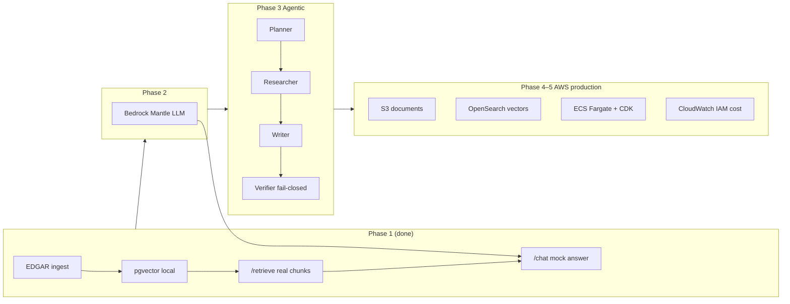

# Old vs new project — `SEC-10-K-RAG` → `sec-filings-agentic-rag-aws`

> **Living doc** — started 2026-06-10 after Phase 1. Update this file as Phases 2–5 land (agentic loop, Bedrock, AWS data plane, deploy).

**Related:** [ARCHITECTURE.md](./ARCHITECTURE.md) · [PHASES.md](./PHASES.md) · [MODEL_AND_PRODUCTION_DECISIONS.md](./MODEL_AND_PRODUCTION_DECISIONS.md) · [PHASE_1.md §6](./PHASE_1.md#6-和旧项目-sec-10-k-rag-的关系)

---

## One-line summary

| Project | What it is |
|---------|------------|
| **`SEC-10-K-RAG`** (prior learning) | Local RAG demo: EDGAR → pgvector → Ollama answers. Proves retrieval + generation works on a laptop. |
| **`sec-filings-agentic-rag-aws`** (this repo) | Same **ingest/retrieve foundation** at first, then **multi-agent orchestration** + **AWS production path** (Bedrock, OpenSearch, S3, ECS). Portfolio piece for infra/platform + AI interviews. |

---

## Why Phase 1 feels similar to the old project

That is **intentional**. Phase 1 reuses patterns you already know so you can focus on new repo structure, contracts, and tests—not re-learning chunking and pgvector.

| Capability | Old `SEC-10-K-RAG` | This repo (after Phase 1) |
|------------|-------------------|---------------------------|
| EDGAR download | ✅ | ✅ `scripts/ingest_edgar.py` |
| Chunk + embed | ✅ MiniLM + tiktoken | ✅ Same stack |
| Vector store | ✅ pgvector (Docker) | ✅ pgvector on `:5433` |
| Vector search | ✅ | ✅ `tools.retrieve()` / `POST /retrieve` |
| LLM answers | ✅ Local **Ollama** | ❌ `/chat` answer still **mock** (Phase 2+) |
| Multi-agent | ❌ | ❌ scaffold only (`Plan`, `agent_steps` in API shape) |
| AWS / deploy | ❌ | ❌ planned Phases 4–5 |

**Practical takeaway:** If you only call `POST /retrieve`, both projects feel alike. The divergence starts at **grounded generation (Phase 2)**, **orchestrator (Phase 3)**, and **cloud data plane (Phase 4–5)**.

---

## What is different from day one (even before agents/AWS)

Phase 0–1 already diverge in **architecture**, not just features:

| Area | Old project | This repo |
|------|-------------|-----------|
| **API contracts** | Ad-hoc request/response | `schemas.py`: `Plan`, `EvidenceChunk`, `AgentStep`, `trace_id` — built for agents |
| **`/chat` role** | Direct RAG pipeline | Future **orchestrator entry**; today wires real `evidence`, mock `answer` |
| **Tool layer** | Retrieve tied to store | `tools.py` — agents call tools; store can swap pgvector → OpenSearch later |
| **Section metadata** | Basic chunks | Chunks carry `section` for citations / verifier (Phase 3) |
| **Engineering** | Learning script style | pytest, CI, structlog, phased docs, env-based config |
| **North star** | “RAG works locally” | “Agentic system + AWS production story” |

Old project = **proof RAG runs**. New project = **proof you can design agent boundaries and grow into AWS**.

---

## Roadmap — where the gap widens



### Target architecture (end state)

From [ARCHITECTURE.md](./ARCHITECTURE.md):

```
Client → FastAPI → Orchestrator
                      ├─ Planner
                      ├─ Researcher (tools: retrieve, get_section, …)
                      ├─ Writer (Bedrock, grounded on evidence)
                      └─ Verifier (citations, fail-closed)

Tools → OpenSearch (vectors) + S3 (documents) + Bedrock (LLM / embeddings)
Deploy → ECS Fargate + CDK + CloudWatch
```

### Phase-by-phase: what gets added

| Phase | Status | Adds | vs old project |
|-------|--------|------|----------------|
| **0** | ✅ Done | Skeleton, mock `/chat`, schemas, CI | Old had no agent-shaped API |
| **1** | ✅ Done | Real ingest + retrieve (AAPL 10-K) | **Same RAG core** as old |
| **2** | Planned | `app/aws.py`, Bedrock Mantle, grounded citations | Cloud LLM instead of Ollama |
| **3** | Planned | `orchestrator.py`, `agents/`, verifier, golden queries | **Core agentic difference** |
| **4** | Planned | S3, OpenSearch, optional Bedrock embed | Data plane leaves the laptop |
| **5** | Planned | ECS Fargate, CDK, alarms, cost notes | **Production deploy** story |

Model stack detail: [MODEL_AND_PRODUCTION_DECISIONS.md](./MODEL_AND_PRODUCTION_DECISIONS.md).

---

## Code mapping (old → new)

Old project path (typical clone): `../SEC-10-K-RAG/`

| Old file | New repo | Notes |
|----------|----------|-------|
| `scripts/download_financial_docs.py` | `scripts/ingest_edgar.py` | Download + chunk + embed + load in one script |
| `src/tiny_rag/ingest.py` | `app/store.py` + ingest script | Schema + vectors in `store.py` |
| `src/tiny_rag/retrieve.py` | `app/store.py` `search_similar` + `app/tools.py` | Tool layer for future agents |
| `docker-compose.yml` | `docker-compose.yml` | pgvector, port **5433** |
| Ollama / local LLM | Phase 2 `app/aws.py` (Mantle) | Not ported—replaced by Bedrock path |
| — | `app/schemas.py`, `app/api.py` | Contracts + HTTP; no equivalent in old repo |
| — | `tests/`, `.github/workflows/` | CI from Phase 0 |

**Strategy:** Migrate and **simplify** logic; do not fork the whole old repo. Enrich metadata (`section`, `filing_id`) for citations and verifier.

More ingest FAQ: [INGEST_EDGAR_FAQ.md](./INGEST_EDGAR_FAQ.md).

---

## When to use which project

| Goal | Use |
|------|-----|
| Quick local RAG + Ollama on a laptop | Old `SEC-10-K-RAG` |
| Interview portfolio: agents + AWS + IaC | **This repo** |
| Reuse chunk/SQL ideas | Either; prefer copying **patterns** into this repo |
| Production SEC research assistant | Neither as-is—this repo’s Phase 4–5 is the intended direction |

---

## Interview one-liner

> “Phase 1 reuses the same local MiniLM + pgvector retrieval I built in an earlier project. This capstone adds agent contracts from day one, then layers Bedrock generation, a Planner–Researcher–Writer–Verifier loop, and an AWS data plane with ECS and CDK—that’s what Phase 2–5 are for.”

---

## Changelog (update as you build)

| Date | Phase | What changed in this doc |
|------|-------|--------------------------|
| 2026-06-10 | 1 done | Initial version: similarity table, day-one differences, roadmap diagram, file mapping |

<!-- Add rows when Phase 2+ ships, e.g.:
| 2026-XX-XX | 2 done | Bedrock Mantle wired; Ollama vs Mantle comparison |
| 2026-XX-XX | 3 done | Orchestrator + verifier; /chat no longer mock pipeline |
-->
