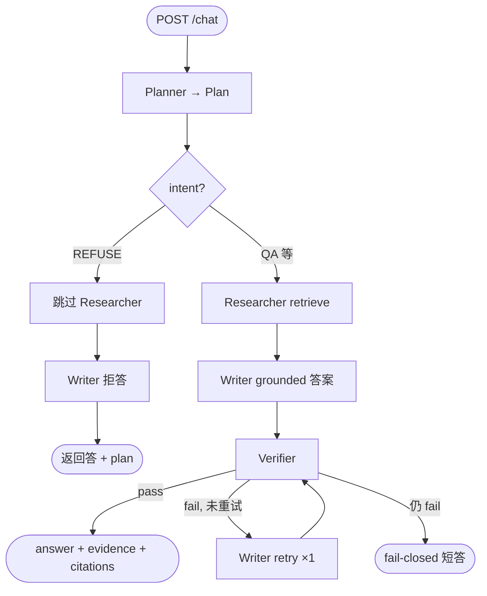

# Phase 3 — Agent orchestrator + verifier

> **状态：** 进行中（Step 1–5 完成；Step 6 接 `api.py` 待做）  
> **目标：** 把 Phase 2 写在 `api.py` 里的线性 RAG 拆成 **Planner → Researcher → Writer → Verifier**；Verifier **fail-closed**，Writer 最多 **1 次**重试。  
> **不改：** `tools.retrieve()`、`llm.chat()`、`prompts.build_rag_prompt()` 对外接口（Phase 4 换 OpenSearch 仍只动 store/tools）。

### 怎么用这个文档（和 Chat 分工）

| 在哪 | 内容 |
|------|------|
| **Chat（Cursor）** | 每一步的 **完整代码** + 行内讲解 → 你复制粘贴到文件 |
| **本文 PHASE_3.md** | **§0 前言 Q&A**（架构与设计）+ 每一步 **做什么、为什么、验证什么**（**不放代码**）+ 做完后的 **实现笔记** |
| **README.md** | 仅 **整 Phase 完成** 时更新状态（不在 README 里记逐步笔记） |

流程：读本文 §0 前言 + 对应 Step → Chat 拿代码 → 粘贴 → 验证 → 在本文该 Step 下写 **实现笔记**、更新 §11 步骤总览表 → 下一步 Chat。

---

## 目录

0. [前言 — Phase 3 开工前的架构 Q&A](#0-前言--phase-3-开工前的架构-qa)
1. [Phase 2 回顾 vs Phase 3 目标](#1-phase-2-回顾-vs-phase-3-目标)
2. [Phase 3 一句话](#2-phase-3-一句话)
3. [要做什么 / 不做什么](#3-要做什么--不做什么)
4. [任务清单（checkbox）](#4-任务清单checkbox)
5. [会新增/修改哪些文件](#5-会新增修改哪些文件)
6. [Agent 数据流与决策树](#6-agent-数据流与决策树)（含 [各步用哪个 model](#各-agent-用不用-modelhybrid-栈--两个-model-分工)）
7. [步骤顺序（建议按天）](#7-步骤顺序建议按天)
8. [验收标准](#8-验收标准)
9. [和 Phase 4 的衔接](#9-和-phase-4-的衔接)
10. [相关文档](#10-相关文档)
11. [分步讲解（无代码）](#11-分步讲解无代码)

---

## 0. 前言 — Phase 3 开工前的架构 Q&A

开工 Phase 3 前在 Chat 里讨论过的架构与设计问题（收录便于复习、面试对照）。按对话顺序排列。

---

### 问答 1 — 整个 architecture 怎么设计的？为啥要这些 agents？

**问（你）：**

> 我想先更多了解下整个 architecture 咋设计的，我们是一个 agentic rag project，会爬取 sec filings，然后智能问答？这些 agents 为啥要这么设计，怎么设计的？

**答：**

#### 这个项目到底是什么？

一句话：**从 SEC 公开财报（10-K / 10-Q）里检索原文，用多 agent 流水线生成带引用的研究型回答**，最终部署在 AWS 上。

不是「随便聊的 ChatGPT」，而是 **research assistant**：

- 数据来源：**EDGAR 公开 filing**（合法、可审计）
- 回答要求：**必须 grounded 在检索到的原文上**
- 每个关键结论要有 **`chunk_id` 引用**

#### 端到端：两层要分开

| 层 | 做什么 | 频率 |
|----|--------|------|
| **Ingest（摄入）** | 下载 filing → 切块 → 向量化 → 入库 | 批处理（`scripts/ingest_edgar.py`） |
| **Query（问答）** | 用户提问 → 检索 → 生成答案 | 每次 `POST /chat` |

「爬取」主要在 **ingest**，不是每次问答都去爬 SEC。问答时只查 **已入库** 的向量库。

```
离线：SEC EDGAR → chunk → MiniLM embed → pgvector
在线：/chat → retrieve → EvidenceChunk → LLM → 带 citation 的 answer
```

#### 现在（Phase 2）vs 目标（Phase 3–5）

**现在：** `api.py` 里直线 `retrieve → prompt → llm`；`plan` / `planner` / `verifier` 是占位。

**目标：**

```
Client → FastAPI → orchestrator.py
                      ├─ Planner
                      ├─ Researcher → tools.retrieve()
                      ├─ Writer     → prompts + llm.chat()
                      └─ Verifier   → citation, fail-closed
Tools → pgvector（现）→ OpenSearch + S3（Phase 4）
LLM   → Mantle（现）→ 可换 classic Bedrock
```

#### 为什么是 Agentic RAG，而不是简单 RAG？

简单 RAG = `问题 → retrieve → LLM`。Phase 2 已是如此。还要拆 agent 的原因：

1. **金融场景要可审计** — 该不该答、查了啥、有没有乱编，分步可观测（`trace_id`、`agent_steps`、`plan`）
2. **职责分离好维护** — 换检索 / 换 LLM / 加 verifier 各改一处
3. **作品集叙事** — 「Planner–Researcher–Writer–Verifier + fail-closed」比「调了下 retrieve」更有辨识度

#### 四个 Agent 怎么来的？

模拟 **研究分析师团队分工**（MVP 里每个 agent 可以很简单，不必一上来 autonomous）：

| Agent | 角色 | 典型要不要 LLM |
|-------|------|----------------|
| **Planner** | 意图、要不要检索、ticker / filing 过滤 | MVP 可 **规则** |
| **Researcher** | 只调 tools 拿 evidence | **不要** |
| **Writer** | 根据 evidence 写答案 | **要** |
| **Verifier** | citation 校验、fail-closed | MVP 可 **规则** |

#### 代码分层（刻意设计）

```
api.py → orchestrator → agents → tools → store
                          ↓
                       llm.py
```

- `api` 不懂数据库；`agents` 不懂 HTTP
- `tools` 稳定接口 — Phase 4 换 OpenSearch 不改 agents
- `llm.py` 稳定接口 — 换模型不改 orchestrator

#### Phase 分阶段逻辑

| Phase | 解决什么 |
|-------|----------|
| 0 | API 契约、测试 |
| 1 | 真数据、真检索 |
| 2 | 真 LLM 答案 |
| **3** | **Agent 编排 + Verifier** |
| 4–5 | 数据上云、ECS 部署 |

---

### 问答 2 — 几个 agent？算 multi-agent 吗？和实习项目比呢？

**问（你）：**

> 我一共几个 agent？算 multi agent 吗？实习项目是 planner、executor、verifier，planner 还要调 sub agents（doc agent、web search 等）。我们是不是类似只有一个 sub agent（doc chat）？RAG 在 doc chat microservice，我们这边是不是类似？当时还有 risk assessment、verifier 等 enhancement layers。

**答：**

#### 几个 agent？

**设计上 4 个角色：** Planner、Researcher、Writer、Verifier。

- **对外说法：** 4-agent orchestration
- **严格说法：** Writer 必调 LLM；Researcher **永不**调 LLM；Planner / Verifier 在 MVP 可用规则

#### 算 multi-agent 吗？

**算，但是「浅层、线性」multi-agent**，不是实习那种 Planner 动态选多个 sub-agent 的 **深层 hierarchical** multi-agent。

| 维度 | 本项目 | 实习生产项目 |
|------|--------|----------------|
| 拓扑 | **一条链** Planner→Researcher→Writer→Verifier | **树/图**：Planner 选 doc / web / … |
| 数据源 | **仅 SEC filing** | Doc + Web + … |
| Sub-agent | **无** | Doc agent、Web search 等 |
| 部署 | 现在 **单体 FastAPI** | **微服务**（doc chat 单独服务） |
| Enhancement | Verifier + REFUSE（Phase 3） | Risk assessment、多层 verifier 等 |

#### 和实习项目的映射

| 实习 | 本项目 |
|------|--------|
| Doc chat microservice（RAG） | `store.py` + `tools.retrieve()`（同进程，逻辑等价） |
| Doc agent（sub-agent） | **Researcher** + `retrieve`（仅 SEC） |
| Web search agent | ❌ 无 |
| Planner 选 sub-agent | Planner 只出 `Plan`，**不动态选** sub-agent |
| Executor | **`orchestrator.py`**（无单独 executor 文件名） |
| Verifier | **Verifier agent** |
| Risk assessment | **Planner REFUSE** + prompt + Verifier（未单独微服务） |

**结论：** 数据能力上像「只有一个 doc RAG」；编排上仍有 **四角色 + verifier 主线**，和实习 **同族但更窄 scope**。

#### 面试话术（推荐）

> 实习是 production 级 hierarchical orchestration（doc、web 等 sub-agent，RAG 在 doc 微服务，上层有 verifier、risk assessment）。Capstone 收窄为单一 SEC 数据源、线性四 agent，重点是 from scratch 的 orchestrator、grounded citation、fail-closed verifier，以及后续 AWS 路径。

---

### 问答 3 — 是不是不是所有 agent 都要 call LLM？Planner 在 plan 什么？

**问（你）：**

> 是不是不是所有 agent 都要 call LLM？Planner 是在 plan 什么呢？Researcher 固定下一步的话，Planner 是不是分担了实习里一些 layer 的职责，但是写在 prompt 里？

**答：**

#### 不是所有 agent 都 call LLM

| Agent | 典型实现 | 要不要 LLM |
|-------|----------|------------|
| Planner | 规则 / 关键词 | MVP **可以不要** |
| Researcher | `tools.retrieve()` | **不要** |
| Writer | `prompts` + `llm.chat()` | **要** |
| Verifier | 正则 / 对照 evidence | MVP **可以不要** |

#### Planner 在 plan 什么？（Researcher 固定下一步仍有意义）

**实习 Planner：** 「调 **哪个** sub-agent？」  
**本项目 Planner：** 「**怎么处理**这个问题？」— 固定顺序，但 **参数与是否执行** 会变。

`Plan` 字段（`schemas.py`）：

- `intent` — qa / summarize / diff / **refuse**
- `need_retrieval` — False 时 **跳过 Researcher**（早停）
- `ticker`, `filing_ids`, `sections` — 检索范围
- `rationale` — 日志 / 调试

例：「我该不该买 AAPL？」→ `REFUSE`, `need_retrieval=False` → 不 retrieve、不浪费 LLM。

#### 实习 layer 职责放在哪？不是全塞进 prompt

| 控制层 | 放什么 | 实现方式 |
|--------|--------|----------|
| **Planner** | 该不该答、要不要查库、查谁 | **代码规则** |
| **Prompt（Writer）** | 只根据 evidence、引 chunk_id、不给投资建议 | **prompt** |
| **Verifier** | citation 是否在 evidence 里 | **代码规则** |

**Prompt 管「怎么写」；Planner / Verifier 管「该不该做、做得对不对」。** 生产里通常多层，不只信 prompt。

实习 **Executor** 职责 ≈ 本项目的 **`orchestrator.py`**（固定顺序 + 处理 retry）。

---

### 问答 4 — 决策树 + 比单纯 RAG 的优势

**问（你）：**

> 先画决策树；我们这种不特别复杂的 multi-agent，比单纯无 agent 的 RAG 优势在哪？

**答：**

#### 决策树（Phase 3 目标态）



**REFUSE 分支：** 在 **进向量库之前** 拦住 — 单纯大 prompt RAG 往往仍会 retrieve + 生成。

**Evidence 不足：** Writer 按 prompt 诚实拒答（Phase 2 revenue 问题已验证）；Verifier 防编造数字。

#### 谁要不要 LLM

```
Planner、Researcher、Verifier → 代码/规则（可不 LLM）
Writer → 必须 LLM
```

#### 比「单纯 RAG（一个函数 retrieve→prompt→LLM）」的优势

| 维度 | 单纯 RAG | 本项目 4 步 agent |
|------|----------|-------------------|
| 拒答 / 合规 | 主要靠 prompt | Planner **早停** + prompt + Verifier |
| 成本 | 啥都 retrieve + LLM | REFUSE **跳过 retrieve** |
| 可观测 | 总 latency | `agent_steps` 每步 ms + `plan` |
| 可测试 | 只能 E2E | 可单测 Planner / Researcher / Verifier |
| 错误恢复 | 少 | Verifier fail → Writer **重试 1 次** |
| 可演进 | 改检索常动全身 | tools / llm / agents 边界清晰 |

**五个具体优势：**

1. Policy 不用赌模型自觉（Planner 代码拒答）
2. 找资料（Researcher）与写答案（Writer）彻底分开
3. `trace_id` + `plan` + `agent_steps` = 生产级可观测
4. Verifier：从「希望守规矩」到「检查有没有守」
5. 复杂度可控，但扩展口在（加数据源、拆微服务改 tools 即可）

**诚实边界：** 若只是内部 demo、无合规、一种数据源 — 一个函数 RAG 也够；本项目选在 **要 citation、拒投资建议、对齐实习 vocabulary** 的区间，适度 agent 拆分划算。

#### 面试一句话

> Capstone 是单 corpus 上的线性四角色编排；相比单纯 RAG，价值在 Planner 早停、Researcher 纯工具检索、Writer grounded 生成、Verifier fail-closed，以及 plan/agent_steps 可观测 — 与实习 doc+verifier 思路同族，scope 更窄、from scratch。

---

## 1. Phase 2 回顾 vs Phase 3 目标

### Phase 2 你已经有什么？

| 类别 | 已完成 |
|------|--------|
| **检索** | `tools.retrieve()` → 真 `EvidenceChunk` |
| **生成** | `llm.chat()` + `prompts.build_rag_prompt()` |
| **`/chat`** | retrieve → prompt → LLM，真 answer + citations |
| **API 形状** | `Plan`、`agent_steps`、`trace_id` 已在 response |
| **Agent 模块** | 四 agent 均在 `app/agents/`（planner / researcher / writer / verifier），单测通过 |
| **Orchestrator** | `orchestrator.run_chat()` 已串联四 agent（Step 5） |
| **仍占位** | `api.py` / `curl /chat` 仍 Phase 2 — **Step 6** 才接 HTTP |

### Phase 3 要补上什么？

**第一次有真 orchestrator**：每个 agent 独立文件，`api.py` 只调 `orchestrator.run_chat()`。

---

## 2. Phase 3 一句话

把 `/chat` 从「api 里写死的四步」改成 **`orchestrator.py` 编排四个 agent**；Verifier 检查 citation，不合格则 Writer 重试一次或 fail-closed。

---

## 3. 要做什么 / 不做什么

### ✅ Phase 3 要做

| # | 事项 |
|---|------|
| 1 | `app/agents/researcher.py` — 调 `tools.retrieve()` |
| 2 | `app/agents/planner.py` — 规则 + `QueryIntent.REFUSE` |
| 3 | `app/agents/writer.py` — `build_rag_prompt` + `llm.chat()` |
| 4 | `app/agents/verifier.py` — citation 校验；fail-closed |
| 5 | `app/orchestrator.py` — 串联；max 1 retry |
| 6 | `app/api.py` 改调 orchestrator；`/health` phase `"3"` |
| 7 | `tests/test_orchestrator.py`、`tests/golden_queries.yaml` |

### ❌ Phase 3 不做

| 事项 | 放到哪 |
|------|--------|
| S3 / OpenSearch / ECS | Phase 4–5 |
| Web search sub-agent | 不做 |
| 复杂多轮 `session_id` | 可选 stretch |
| DIFF 两期 filing 完整实现 | 先 stub `QueryIntent.DIFF` |

---

## 4. 任务清单（checkbox）

完成一项勾一项；逐步 **实现笔记** 写在本文 §11 各 Step 下（整 Phase 验收通过后再填 `README.md` Phase 3 的 Done notes）。

### A. Agents

- [x] `app/agents/` 包 + `researcher.py`
- [x] `planner.py`
- [x] `writer.py`
- [x] `verifier.py`

### B. 编排与 API

- [x] `orchestrator.py`
- [ ] `api.py` 调 orchestrator
- [ ] `/health` → `"phase": "3"`

### C. 测试与验收

- [x] `tests/test_researcher.py`
- [x] `tests/test_planner.py`
- [x] `tests/test_writer.py`
- [x] `tests/test_verifier.py`
- [x] `tests/test_orchestrator.py`
- [ ] `tests/golden_queries.yaml`
- [x] `pytest -q` 全绿（当前 **33 passed**）
- [ ] curl 3 条 golden query + REFUSE 样例（Step 6 接 orchestrator 后）

---

## 5. 会新增/修改哪些文件

```
sec-filings-agentic-rag-aws/
├── app/
│   ├── agents/
│   │   ├── __init__.py
│   │   ├── planner.py
│   │   ├── researcher.py
│   │   ├── writer.py
│   │   └── verifier.py
│   ├── orchestrator.py       # 新建 — 主循环
│   └── api.py                # 修改 — 薄层调 orchestrator
├── tests/
│   ├── test_researcher.py
│   ├── test_planner.py
│   ├── test_orchestrator.py
│   └── golden_queries.yaml
└── docs/PHASE_3.md           # 本文
```

**Phase 3 不改：** `store.py`、`llm_mantle.py`、`tools.retrieve()` 签名（除非 bug fix）。

---

## 6. Agent 数据流与决策树

### 线性数据流

```
ChatRequest
    ↓
Planner → Plan
    ↓
Researcher → list[EvidenceChunk]     ← tools.retrieve()
    ↓
Writer → answer str                  ← prompts + llm.chat()
    ↓
Verifier → pass | retry | fail-closed
    ↓
ChatResponse
```

### 决策树（详见 §0 问答 4）

- **REFUSE** → 跳过 Researcher
- **QA + 有 evidence** → 正常 Writer → Verifier
- **Verifier fail** → Writer retry ×1 → 仍 fail → fail-closed

### 各 Agent 用不用 model？（Hybrid 栈 — 两个 model 分工）

Phase 3 **不是**「一个 model 跑全程」。日志里若看到两个 model 名，是 **检索** 和 **生成** 各用各的（Phase 2 定下的 hybrid 路径，Phase 3 orchestrator 不变）。

| Agent | 是否调 ML model | 用的什么 | 配置 / 代码 |
|-------|-----------------|----------|-------------|
| **Planner** | ❌ 否 | 关键词规则 | `planner.py` |
| **Researcher** | ✅ **Embedding** | `all-MiniLM-L6-v2`（本地 sentence-transformers） | `.env` → `EMBEDDING_MODEL`；`store.py` 加载；向量在 pgvector |
| **Writer** | ✅ **LLM 生成** | `qwen.qwen3-coder-next`（AWS Bedrock **Mantle**） | `.env` → `MANTLE_MODEL_ID`；`llm.py` → `llm_mantle.py` |
| **Verifier** | ❌ 否 | 正则 + 规则对照 evidence | `verifier.py` |

**REFUSE 路径更省：** Planner 拒答 → Researcher 跳过 → Writer **固定文案、不调 Mantle** → Verifier 跳过 citation 检查。

#### 一次 QA 请求里日志长什么样（Step 5 E2E 实测）

以 `run_chat(query="What are risk factors?", ticker="AAPL")` 为例：

```
planner_done          intent=qa          ← 无 model
loading_embedding_model  model=all-MiniLM-L6-v2   ← Researcher 检索前（首次较慢）
researcher_done       chunk_count=5      ← MiniLM embed + pgvector
llm_chat              provider=mantle
mantle_chat_request   model=qwen.qwen3-coder-next   ← Writer 写答案
mantle_chat_done      finish_reason=stop
verifier_done         cited_count=6 detail=citations ok   ← 无 model
orchestrator_done     verifier_passed=True
```

**怎么记：**

1. **Researcher 步** → 日志出现 `all-MiniLM-L6-v2` = 把问题变成向量去搜 filing chunks。  
2. **Writer 步** → 日志出现 `qwen.qwen3-coder-next` = 读 evidence 写人话答案。  
3. **不是多模型乱用**，是 RAG 标准拆法：embed 检索 + LLM 生成。

更全的模型决策见 [PHASE_2.md §6](./PHASE_2.md#6-模型栈谁负责-embed谁负责-llm)、[MODEL_AND_PRODUCTION_DECISIONS.md](./MODEL_AND_PRODUCTION_DECISIONS.md)。

---

## 7. 步骤顺序（建议按天）

| Step | 主题 | 主要文件 |
|------|------|----------|
| 1 | Researcher agent | `agents/researcher.py`, `test_researcher.py` |
| 2 | Planner agent | `agents/planner.py`, `test_planner.py` |
| 3 | Writer agent | `agents/writer.py` |
| 4 | Verifier agent | `agents/verifier.py` |
| 5 | Orchestrator | `orchestrator.py` |
| 6 | 接 API + 测试 | `api.py`, `test_orchestrator.py`, 更新 `test_chat_rag.py` |
| 7 | Golden eval + E2E | `golden_queries.yaml`, curl, 更新 README |

---

## 8. 验收标准

### Golden queries（与 Phase 2 相同 3 条）

1. What are the main risk factors?（AAPL）
2. What was total net sales or revenue?（AAPL）
3. What does the company do? Business overview.（AAPL）

### 额外验收

4. 「Should I buy AAPL?」类 → `intent=refuse`，不 retrieve（或极短拒答）

### 通过条件

- [ ] `agent_steps` 四步均为真 latency（verifier 非 mock pass）
- [ ] Verifier 单测：无 citation 的断言 → fail
- [ ] `GET /health` → `"phase": "3"`
- [ ] `pytest -q` 全绿

---

## 9. 和 Phase 4 的衔接

Phase 3 的 Researcher **只**调 `tools.retrieve()`。Phase 4 把 `store.search_similar` 换成 OpenSearch 时，**agents 与 orchestrator 不用改**。

---

## 10. 相关文档

- [PHASE_2.md](./PHASE_2.md) — 已完成 Mantle `/chat`
- [ARCHITECTURE.md](./ARCHITECTURE.md) — 目标架构图
- [OLD_VS_NEW_PROJECT.md](./OLD_VS_NEW_PROJECT.md) — vs 旧 RAG / 实习叙事
- [MODEL_AND_PRODUCTION_DECISIONS.md](./MODEL_AND_PRODUCTION_DECISIONS.md) — agent + 生产控制
- [TOKEN_AND_COST_CONTROL.md](./TOKEN_AND_COST_CONTROL.md) — REFUSE 早停与成本
- [PYTEST.md](./PYTEST.md) — pytest、mock、`tests/` 索引
- [GOLDEN_QUERIES.md](./GOLDEN_QUERIES.md) — `golden_queries.yaml`、手动 E2E、与 CI 分工

---

## 11. 分步讲解（无代码）

### 步骤总览

| Step | 主题 | 主要文件 | 状态 |
|------|------|----------|------|
| 1 | Researcher | `app/agents/researcher.py` | ✅ 2026-06-12 |
| 2 | Planner | `app/agents/planner.py` | ✅ 2026-06-12 |
| 3 | Writer | `app/agents/writer.py` | ✅ 2026-06-12 |
| 4 | Verifier | `app/agents/verifier.py` | ✅ 2026-06-12 |
| 5 | Orchestrator | `app/orchestrator.py` | ✅ 2026-06-12 |
| 6 | API + tests | `api.py`, tests | |
| 7 | E2E + docs | golden_queries, README | |

---

### Step 1 — Researcher `app/agents/researcher.py`

**目标：** 把 `api.py` 里的 `retrieve(...)` 抽成独立 agent；入参 `Plan` + `query`，出参 `(chunks, latency_ms)`。

**为什么要做：** Researcher 是 orchestrator 里第一个「真工具调用」agent；先 isolated 测通，再叠 Planner / Writer。

**要新建：**

- `app/agents/__init__.py`
- `app/agents/researcher.py` — `run_research(query, plan, *, top_k=5)`
- `tests/test_researcher.py` — mock `app.agents.researcher.retrieve`

**行为：**

- `plan.need_retrieval=False` → 返回 `([], 0.0)`，不调 retrieve
- `plan.ticker` 为空 → 默认 `"AAPL"`
- structlog `researcher_done`

**验证：** `pytest tests/test_researcher.py -q` → 3 passed；`pytest -q` 全绿。

**本步不做：** 改 `api.py`（Step 6 统一接 orchestrator）。

**实现笔记（2026-06-12）：**

| 子步骤 | 做了什么 |
|--------|----------|
| `researcher.py` | `run_research(query, plan)` 封装 `tools.retrieve()` + 计时 |
| skip 逻辑 | `need_retrieval=False` → `([], 0.0)`，log `researcher_skipped` |
| 默认 ticker | `plan.ticker or "AAPL"` |
| 测试 | `test_researcher.py` 3 cases；patch `app.agents.researcher.retrieve` |
| 验证 | `pytest -q` 14 passed（+3） |

---

### Step 2 — Planner `app/agents/planner.py`

**目标：** 根据 `ChatRequest` 产出真 `Plan`（替代 api 里写死的 Plan）。

**规则优先（MVP）：**

- buy/sell / 投资建议关键词 → `QueryIntent.REFUSE`, `need_retrieval=False`
- 默认 → `QueryIntent.QA`, `need_retrieval=True`
- 透传 `ticker`, `filing_ids`

**验证：** `pytest tests/test_planner.py -q` → 6 passed；全量 **20 passed**

**实现笔记（2026-06-12）：**

| 子步骤 | 做了什么 |
|--------|----------|
| `planner.py` | 规则 MVP：`REFUSE` / `SUMMARIZE` / `DIFF` / `QA`；不调 LLM |
| REFUSE | 投资建议关键词 + `\b(buy\|sell)\b` → `need_retrieval=False` |
| 透传 | `ticker`、`filing_ids` 进 `Plan` |
| 测试 | `test_planner.py` 6 cases；**无需 mock** |
| 串联验证 | `run_planner` + `run_research("Should I buy AAPL?")` → `REFUSE`, 0 chunks |
| 注意 | `curl /chat` 仍走 Phase 2 `api.py` 写死 Plan — Step 6 才 HTTP 层 REFUSE |

---

### Step 3 — Writer `app/agents/writer.py`

**目标：** 封装 `build_rag_prompt` + `llm.chat()`，返回 `(answer, latency_ms)`。

**为什么要做：** Phase 2 逻辑从 api 迁入 Writer；orchestrator 只编排，不写 prompt 细节。

**验证：** `pytest tests/test_writer.py -q` → 3 passed；全量 **23 passed**

**实现笔记（2026-06-12）：**

| 子步骤 | 做了什么 |
|--------|----------|
| `writer.py` | `build_rag_prompt` + `llm.chat()`；返回 `(answer, latency_ms)` |
| REFUSE | `QueryIntent.REFUSE` → 固定 `REFUSE_ANSWER`，**不调 LLM** |
| retry 预留 | `verifier_feedback` 追加进 user prompt（Step 5 orchestrator 用） |
| 测试 | `test_writer.py` 3 cases；patch `app.agents.writer.llm_chat` |
| 串联 | Planner→Researcher→Writer：`Should I buy AAPL?` → 拒答文案 |

---

### Step 4 — Verifier `app/agents/verifier.py`

**目标：** 检查 answer 里 `[chunk_id]` 是否都在 evidence 中。

**返回：** `VerifierResult(passed: bool, detail: str, retry_hint: str | None)`

**fail-closed：** 有 factual claims 但零 citation → `passed=False`

**验证：** `pytest tests/test_verifier.py -q` → 6 passed；全量 **29 passed**

**实现笔记（2026-06-12）：**

| 子步骤 | 做了什么 |
|--------|----------|
| `verifier.py` | `verify_answer()` → `VerifierResult(passed, detail, retry_hint)` |
| citation | 正则抽 `[chunk_id]`，必须在 evidence 内 |
| fail-closed | 有 evidence、无 citation、非诚实拒答 → fail + `retry_hint` |
| REFUSE | 跳过 citation 检查 |
| 测试 | `test_verifier.py` 6 cases；**无需 mock** |
| 串联 | 四 agent 可手动 `python -c` 串；**尚无 orchestrator** — Step 5 |
| 注意 | 假 chunk `id='x'` 时 LLM 若诚实拒答，verifier 可 pass（`honest refusal` 启发式） |

---

### Step 5 — Orchestrator `app/orchestrator.py`

**目标：** `run_chat(request: ChatRequest) -> ChatResponse`；串联四 agent；verifier 失败时 writer 最多再跑 1 次。

**验证：** `pytest tests/test_orchestrator.py -q` → 4 passed；全量 **33 passed**；`run_chat` REFUSE + QA E2E 见 [§6 Hybrid 栈](#各-agent-用不用-modelhybrid-栈--两个-model-分工)

**实现笔记（2026-06-12）：**

| 子步骤 | 做了什么 |
|--------|----------|
| `orchestrator.py` | `run_chat()`：planner → researcher → writer → verifier |
| retry | verifier fail 且有 `retry_hint` → writer 再跑 1 次 |
| fail-closed | 仍 fail → `FAIL_CLOSED_ANSWER`，保留 evidence |
| `agent_steps` | 四步真 latency；writer detail = `llm_provider`（+ `retry once`） |
| 测试 | `test_orchestrator.py` 4 cases；patch `app.orchestrator.run_*` |
| E2E REFUSE | `Should I buy AAPL?` → 0 evidence，拒答，verifier pass |
| E2E QA | risk factors → 5 chunks，Mantle 答案，verifier `citations ok`（6 cites） |
| 注意 | `curl /chat` 仍走 `api.py` Phase 2 — Step 6 |

---

### Step 6 — 接 `api.py` + 测试

**目标：** `/chat` 调 `orchestrator.run_chat`；更新 `test_chat_rag.py` patch 点。

**注意：** 若 `api.py` 为 `from app.orchestrator import run_chat`，则 patch **`app.api.run_chat`** 或 orchestrator 内依赖。

**实现笔记：** _（Step 6 完成后填写）_

---

### Step 7 — Golden eval + E2E

**目标：** `tests/golden_queries.yaml` + curl；更新 `README.md`、`PHASES.md`、`OLD_VS_NEW_PROJECT.md`。

**实现笔记：** _（Step 7 完成后填写）_

---

## Done notes（Phase 3 全部完成后填写）

- **日期：**
- **pytest / curl 摘要：**
- **Verifier / REFUSE 行为举例：**
- **学到的点：**
